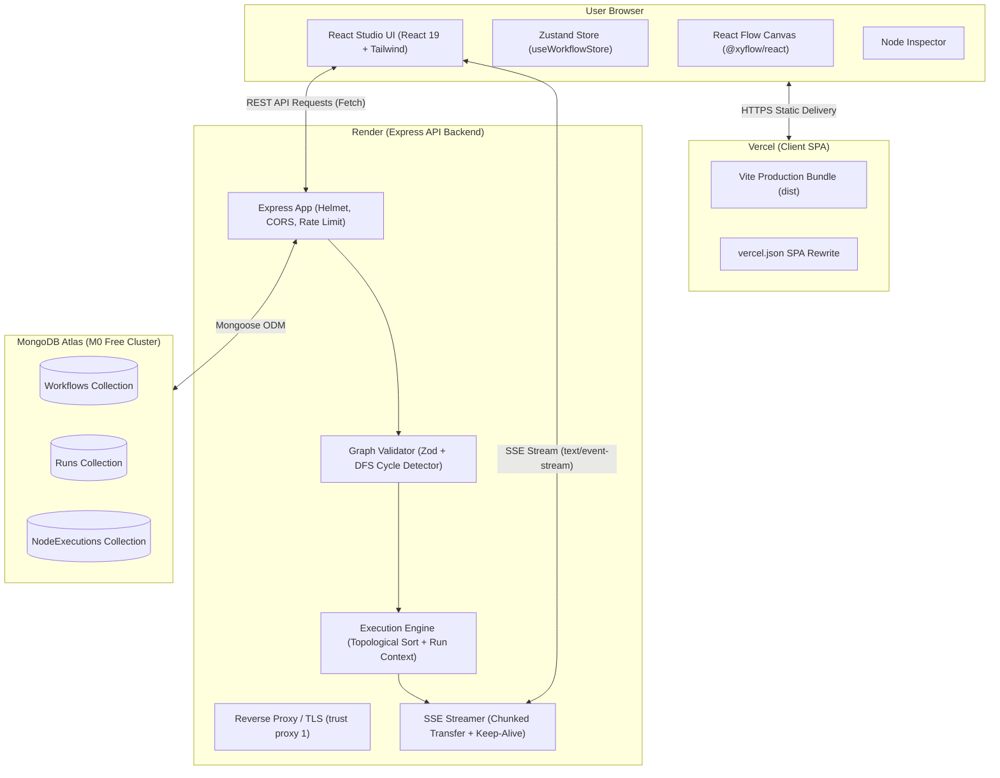

# Matter

> **Build logic visually. Execute it for real. Debug every step.**

Matter is a visual programming environment paired with a real backend execution engine. Users compose directed workflow pipelines on an interactive canvas, validate graph topologies, stream execution state in real time over Server-Sent Events (SSE), inspect intermediate variable states, and replay past execution runs.

[](https://matter-delta.vercel.app/)
[](https://matter-api-smno.onrender.com/api/health)
[](https://github.com/amannarang04/Matter)
[](https://drive.google.com/file/d/1Gom53oHbWXGHqmvgSPUQdTZNHz-D5Ypm/view?usp=sharing)

- **Live Frontend Studio**: [https://matter-delta.vercel.app/](https://matter-delta.vercel.app/)
- **Live Backend API Health**: [https://matter-api-smno.onrender.com/api/health](https://matter-api-smno.onrender.com/api/health)
- **GitHub Repository**: [https://github.com/amannarang04/Matter](https://github.com/amannarang04/Matter)
- **Walkthrough Demo Video**: [Watch Demo Video (Google Drive)](https://drive.google.com/file/d/1Gom53oHbWXGHqmvgSPUQdTZNHz-D5Ypm/view?usp=sharing)

---

## Problem Statement & Target Users

### Problem Statement
Traditional visual pipeline tools and block-based editors are frequently superficial toys: they simulate logic inside browser memory, fail to validate real dependency graphs, lack backend persistence, and execute untrusted user code via dangerous JavaScript `eval()` constructs. Conversely, production orchestration engines (such as Temporal or Airflow) present steep learning curves, complex boilerplate, and opaque local setups for non-specialists.

Matter bridges this gap: a clean, visual drag-and-drop studio backed by an Express and MongoDB execution engine that enforces strict Directed Acyclic Graph (DAG) validation, sandboxed non-eval arithmetic operations, live SSE node streaming, and historical state replay.

### Target Users
1. **Students Learning Computational Logic**: Visual learners who want to see how topological sorting, conditional branching, and variable scoping work under the hood.
2. **Software Engineers Prototyping Workflows**: Developers creating rule engines, data transformations, or branching calculations who need instant visual feedback before hardcoding business logic.
3. **Beginners & Technical Explorers**: Anyone wanting to visually inspect step-by-step data flow, execution timings, and error states across discrete processing nodes.

---

## Solution & Key Features

Matter delivers a full-stack, production-ready workflow platform where users can:

- **Construct Visual Pipelines**: Add, reposition, connect, and delete nodes and edges freely on an infinite pan-and-zoom grid powered by `@xyflow/react`.
- **Configure 6 Discrete Node Types**:
  - `Input`: Initializes raw values (`number`, `string`, `boolean`) into the run context.
  - `Math`: Performs arithmetic (`add`, `subtract`, `multiply`, `divide`) on literal values or context references, writing results to an explicit `outputKey`.
  - `Condition`: Evaluates binary comparisons (`gt`, `lt`, `eq`, `gte`, `lte`, `neq`) and selectively activates downstream outgoing edges through `"true"` and `"false"` handles.
  - `Transform`: Applies string conversions, rounding, or numeric adjustments (`toString`, `round`, `add`, `multiply`) without arbitrary code execution.
  - `Delay`: Introduces a non-blocking asynchronous sleep (0 to 5000ms) to simulate real-world service latency.
  - `Output`: Aggregates resolved context references into a finalized structured payload.
- **Enforce Backend Graph Validation**: Every save and run strictly validates edge references, checks for cycles using Depth-First Search (DFS), verifies that `outputKey` identifiers are unique and valid, ensures at least one input node exists, and enforces limits (50 nodes, 100 edges, 5000ms max delay).
- **Stream Real-Time Execution over SSE**: Watch nodes highlight dynamically (`running` &rarr; `success` / `failed` / `skipped`) with live execution logs streamed directly over an HTTP Server-Sent Events connection.
- **Inspect Detailed Node Telemetry**: Selecting any node displays an **Execution** telemetry panel with real-time status badges, duration in milliseconds, resolved runtime inputs, produced outputs, and plain-language errors.
- **Replay Historical Runs on the Canvas**: Load past runs from MongoDB and project historical node statuses (`success`, `failed`, `skipped`) onto the canvas with an active banner and workflow drift warning without triggering a new run.
- **One-Click Failure Recovery ("Fix and Rerun")**: When execution halts (e.g. division by zero), Matter highlights the failed node in red, displays a plain-language error banner, and provides a `"Fix and rerun"` button that auto-saves corrections and initiates a fresh execution.
- **Persist Workflows & Runs in MongoDB**: Workflows, execution records, and granular per-node execution telemetry (inputs, outputs, status, error, duration) are durably stored in MongoDB Atlas and automatically restored across browser refreshes.

---

## Try It in 60 Seconds

1. Open the live studio at [https://matter-delta.vercel.app/](https://matter-delta.vercel.app/).
2. *Note on free tier*: If the backend is asleep on Render, a notice banner (`Waking up the server...`) will appear. Render takes ~30–50 seconds to boot on a cold start.
3. In the top navigation bar, open the **Templates** dropdown and select **Discount & Tier Evaluation**.
4. Click the green **Run Workflow** button. Observe live nodes lighting up: the `Premium Tier Output` branch executes and succeeds, while the `Standard Tier Output` branch is marked `skipped`.
5. Click the **Calculate Discount** math node to open the Inspector. Change **Operation** from `multiply` to `divide` and set the right operand to a literal value of `0`.
6. Click **Run Workflow**. Notice execution halts: the node turns red, and the bottom panel displays: `Division by zero in math node "node-2"`.
7. In the Inspector, change **Operation** back to `multiply`. Click the red **Fix and rerun** button in the bottom error banner. A new run starts and completes successfully.

---

## Tech Stack

| Layer | Technology | Rationale |
| :--- | :--- | :--- |
| **Frontend UI** | React 19 + Vite | Fast bundling, modern concurrent rendering, and rapid hot module replacement (HMR). |
| **Visual Canvas** | `@xyflow/react` (v12) | Industry-standard node-graph canvas with smooth panning, zooming, and customizable node handles. |
| **State Management** | Zustand | Lightweight, centralized client store managing nodes, edges, SSE streams, modal states, and replay caches without Redux boilerplate. |
| **Styling** | Vanilla CSS + Tailwind CSS v4 | Curated dark-mode palette (`slate-950`), custom borders, glassmorphic panels, and responsive layouts. |
| **Backend Framework** | Node.js + Express 5 | Robust, lightweight asynchronous web framework perfectly suited for streaming SSE events and REST endpoints. |
| **Database & ODM** | MongoDB + Mongoose 9 | Flexible document model for storing arbitrary graph topologies, run contexts, and granular per-node execution records. |
| **Schema Validation** | Zod | Declarative, runtime type validation for graph limits, operand shapes, and node configurations. |
| **Testing** | Vitest | Fast, native ESM unit and integration testing with minimal configuration overhead. |
| **Hosting** | Vercel (Client) + Render (Server) + MongoDB Atlas | Zero-cost production hosting stack with automated Git deployments and worldwide CDN delivery. |

---

## Architecture



### Component Overview & Request Flow
1. **Studio Client (Browser & Vercel)**: The React single-page application manages user actions, node edits, and canvas connections through Zustand. All API communication uses standard native fetch with fallback polling if the streaming connection drops.
2. **Reverse Proxy & Express Server (Render)**: Express sits behind Render's reverse proxy with `trust proxy 1` enabled, enforcing Helmet security headers, CORS origin restrictions (`CLIENT_ORIGIN`), and a 30-run-per-15-minute rate limit.
3. **Graph Validation**: Incoming workflow payloads pass through Zod schemas and a recursive DFS algorithm that validates structure and detects circular dependencies before any code executes.
4. **Execution Engine**: When a run is triggered:
   - The engine generates a topological execution queue using Kahn's algorithm.
   - Evaluates each node sequentially within a shared key-value **Run Context**.
   - Emits real-time SSE events (`type: "node"`, `type: "run"`) to the client.
   - Persists final run outputs and individual node executions into MongoDB.
5. **MongoDB Atlas**: Stores workflow definitions in `workflows`, execution run records in `runs`, and per-node input/output/duration telemetry in `nodeexecutions`.

---

## How the Execution Engine Works

### 1. Validation & Topological Ordering (Kahn's Algorithm)
Before execution begins, the engine constructs an in-degree map and an adjacency list from the workflow's nodes and edges. It executes Kahn's algorithm (`topologicalSort`) to determine the exact sequential execution order:
- Computes in-degrees for all nodes.
- Enqueues nodes with an in-degree of 0 (e.g. input nodes).
- Iteratively removes nodes from the queue, decrements neighbors' in-degrees, and queues nodes whose in-degree becomes 0.
- If the count of sorted nodes does not equal the total number of nodes, execution halts immediately with a `VALIDATION_ERROR` indicating a cycle.

### 2. The Run Context Model & Operand Shape
Data flows downstream strictly through a shared key-value dictionary called the **Run Context**. Nodes never inspect another node's private internal state; they publish results under a user-defined `outputKey` and read variables using a standardized **Operand Shape**:

```json
// Literal Operand
{ "source": "literal", "value": 1500 }

// Context Reference Operand
{ "source": "ref", "key": "discountRate" }
```

### 3. Condition Branching & Skipped Nodes
Condition nodes evaluate logical operators (`gt`, `lt`, `eq`, `gte`, `lte`, `neq`). They write nothing to the context but select an active outgoing branch by matching the result to edge `sourceHandle` values (`"true"` or `"false"`).
- **Branching Rule**: A downstream node is marked **Skipped** (`status: "skipped"`) if all incoming paths that reach it originate from an unselected condition branch.
- Skipped nodes emit a zero-duration event, skip computation, pass inactivity downstream, and contribute nothing to `finalOutput`.

### 4. Timeout & Stuck-Run Safety
- **30-Second Timeout**: The execution engine wraps execution in a `Promise.race()` with a 30,000ms timer. If execution exceeds this window, the run transitions to `failed` with a timeout error.
- **Finally Guard**: In `workflowService.js`, the execution block is protected by a `try ... finally` block. Every possible exit path (success, math error, timeout, or crash) writes `status`, `completedAt`, and `errorSummary` to MongoDB, guaranteeing that the duplicate-run lock (`409 CONCURRENT_RUN_CONFLICT`) is released.
- **Startup Recovery**: When the server boots up, `recoverStuckRuns()` executes before `app.listen()`. Any runs left in `pending` or `running` state (e.g. if the Render container restarted mid-flight) are marked as `failed` with:
  `"Run was interrupted by a server restart"`.

### Worked Example: Discount & Tier Evaluation
```text
[Input Prices] (originalPrice: 1500, discountRate: 0.1)
      │
      ▼
[Calculate Discount] (originalPrice * discountRate = 150) -> context.discount
      │
      ▼
[Calculate Discounted Price] (originalPrice - discount = 1350) -> context.discountedPrice
      │
      ▼
[Check Price Threshold] (discountedPrice > 1000) -> true
      ├── (true handle)  ──▶ [Premium Tier Output]  ===> RUNS (category: "Premium")
      └── (false handle) ──▶ [Standard Tier Output] ===> SKIPPED
```

**Final Output**:
```json
{
  "originalPrice": 1500,
  "discount": 150,
  "discountedPrice": 1350,
  "category": "Premium"
}
```

---

## Key Engineering Decisions

1. **Backend Execution Over Browser Evaluation**: Workflows run entirely on the Node.js backend rather than in the browser. This guarantees reproducible execution independent of client hardware, allows headless execution, enables durable database audit logging, and maintains a strict boundary between presentation and computation.
2. **Explicit Handler Registry (Zero `eval` / `Function`)**: Matter uses a closed dictionary of operations inside [`executionEngine.js`](file:///d:/mern_endterm_project/matter/server/src/services/executionEngine.js). The transform and math handlers use static JavaScript primitives (`+`, `-`, `*`, `/`, `Math.round()`, `String()`). Arbitrary string-to-code execution (`eval()`, `new Function()`, `vm`) is strictly excluded, eliminating Remote Code Execution (RCE) vectors.
3. **SSE Streaming with Polling Fallback**: Server-Sent Events (SSE) were chosen over WebSockets because execution updates are unidirectional (server to client) and run over standard HTTP/1.1 without stateful socket connection handshakes. If a proxy drops the SSE connection, the client automatically falls back to polling `GET /api/runs/:id` until a terminal status is returned.
4. **Unselected Branch Propagation**: Instead of halting execution on condition branches, the engine tracks edge activation states. Unselected branches propagate an inactive flag downstream so nodes accurately reflect a `skipped` status on the visual canvas.
5. **Separate Runs and NodeExecutions Collections**: Execution summaries are stored in a `runs` collection, while individual step telemetry is saved to `nodeexecutions`. This separation enables fast history queries while allowing deep inspection of inputs, outputs, and errors for any given node step.
6. **No Loops or Parallel Branch Merges**: The engine is intentionally restricted to Directed Acyclic Graphs (DAGs) without cyclical loops. This simplifies topological ordering, prevents infinite run conditions, and keeps execution deterministic for the submission scope.
7. **Production Reverse Proxy Hardening**: Because Render operates behind reverse proxies, Matter configures `app.set('trust proxy', 1)`. The backend sends periodic `: ping` heartbeats every 15 seconds, sets `X-Accel-Buffering: no` to prevent proxy buffer delays, and uses per-IP rate limiting (`express-rate-limit`).

---

## Folder Structure

```text
matter/
├── client/                     # Frontend Single Page Application
│   ├── public/                 # Static assets (favicons, icons)
│   ├── src/
│   │   ├── components/         # React presentation components
│   │   │   ├── canvas/         # React Flow canvas wrapper & node palette
│   │   │   ├── history/        # Run history modal & past run inspector
│   │   │   ├── inspector/      # Sidebar configuration & execution telemetry
│   │   │   ├── nodes/          # Custom node components (Base, Math, Delay, etc.)
│   │   │   └── workflow/       # Top header, execution drawer, & error banner
│   │   ├── services/           # API fetch client & SSE streaming reader
│   │   ├── store/              # Zustand global state (workflowStore.js)
│   │   ├── utils/              # Workflow templates & helper constants
│   │   ├── App.jsx             # Root layout with waking and replay banners
│   │   └── main.jsx            # React 19 entrypoint
│   ├── package.json            # Client scripts & dependencies
│   ├── vercel.json             # Vercel SPA client rewrite rules
│   └── vite.config.js          # Vite build & Tailwind CSS plugin configuration
├── docs/                       # Project specifications & operational guides
│   ├── CONTRACT.md             # Data contract, schemas, & REST API specifications
│   ├── DEPLOY.md               # Step-by-step Atlas, Render, & Vercel deployment guide
│   ├── PROJECT_REPORT.md       # Comprehensive evaluation & architecture defense report
│   └── SUBMISSION.md           # Submission details & guidelines checklist
├── server/                     # Backend API & Execution Engine
│   ├── src/
│   │   ├── config/             # MongoDB database connection logic
│   │   ├── controllers/        # Express request handlers (Workflow & Run)
│   │   ├── middleware/         # Helmet, CORS, Rate Limiter, & Error Handler
│   │   ├── models/             # Mongoose schemas (Workflow, Run, NodeExecution)
│   │   ├── routes/             # Express API routing definitions
│   │   ├── services/           # Topological execution engine & workflow services
│   │   ├── utils/              # Zod graph validator, SSE writer, & seed script
│   │   ├── app.js              # Express app configuration & middleware pipeline
│   │   └── server.js           # Server bootstrap, DB connect, & startup recovery
│   ├── tests/                  # Vitest test suite
│   │   ├── api.test.js         # Integration tests for workflows, runs, & recovery
│   │   ├── engine.test.js      # Unit tests for DAG sorting, math, & branching
│   │   ├── health.test.js      # CORS, preflight, & health check tests
│   │   └── proxyRateLimit.test.js # Rate limiting & reverse proxy IP tests
│   └── package.json            # Server scripts, dependencies, & test configuration
├── render.yaml                 # Infrastructure-as-code spec for Render Web Service
└── README.md                   # Project landing documentation
```

---

## Local Setup

### Prerequisites
- **Node.js**: v18.0.0 or later (v20+ recommended)
- **npm**: v9.0.0 or later
- **MongoDB**: Local MongoDB instance running on `mongodb://127.0.0.1:27017` or a MongoDB Atlas connection URI

### 1. Clone the Repository
```bash
git clone https://github.com/amannarang04/Matter.git
cd Matter
```

### 2. Configure Environment Variables
Create the `.env` files in both `server/` and `client/` directories from their provided examples:

```bash
# Server configuration
cp server/.env.example server/.env

# Client configuration
cp client/.env.example client/.env
```

### 3. Install Dependencies
```bash
# Install backend dependencies
cd server
npm install

# Install frontend dependencies
cd ../client
npm install
cd ..
```

### 4. (Optional) Seed the Database
Populate your database with the default `Discount & Tier Evaluation` workflow:
```bash
cd server
npm run seed
cd ..
```

### 5. Start the Development Servers
In two separate terminal windows:

**Terminal 1 (Backend Server)**:
```bash
cd server
npm run dev
# Starts server with node --watch on http://localhost:5000
```

**Terminal 2 (Frontend Client)**:
```bash
cd client
npm run dev
# Starts Vite dev server on http://localhost:5173
```

Open `http://localhost:5173` in your browser to launch the studio.

---

## Environment Variables

### Server (`server/.env`)
| Variable | Description | Example Placeholder |
| :--- | :--- | :--- |
| `PORT` | Local port for Express listener | `5000` |
| `MONGODB_URI` | MongoDB connection connection string | `mongodb://127.0.0.1:27017/matter` or `mongodb+srv://<user>:<password>@<cluster>.mongodb.net/matter?retryWrites=true&w=majority` |
| `CLIENT_ORIGIN` | Allowed CORS origins (comma-separated for multiple) | `http://localhost:5173,https://matter-delta.vercel.app` |

### Client (`client/.env`)
| Variable | Description | Example Placeholder |
| :--- | :--- | :--- |
| `VITE_API_URL` | Base URL of the backend API service (no trailing slash) | `http://localhost:5000` or `https://matter-api-smno.onrender.com` |

---

## API Reference

### REST Endpoints
| Method | Path | Purpose | Success Status | Error Codes |
| :--- | :--- | :--- | :---: | :--- |
| `GET` | `/api/health` | Health & DB connection readiness check | `200` (`503` if degraded) | - |
| `POST` | `/api/workflows` | Create a new workflow definition with graph validation | `201` | `VALIDATION_ERROR` (400) |
| `GET` | `/api/workflows` | List all saved workflows sorted by update timestamp | `200` | - |
| `GET` | `/api/workflows/:id` | Retrieve single workflow definition by ID | `200` | `NOT_FOUND` (404) |
| `PUT` | `/api/workflows/:id` | Update an existing workflow definition | `200` | `VALIDATION_ERROR` (400), `NOT_FOUND` (404) |
| `DELETE`| `/api/workflows/:id` | Delete workflow and cascade delete associated runs | `200` | `NOT_FOUND` (404) |
| `POST` | `/api/workflows/:id/execute` | Execute workflow (supports synchronous JSON or `?stream=true` SSE stream) | `200` | `VALIDATION_ERROR` (400), `NOT_FOUND` (404), `CONCURRENT_RUN_CONFLICT` (409), `RATE_LIMIT_EXCEEDED` (429) |
| `POST` | `/api/workflows/:id/run` | Execution alias for `/api/workflows/:id/execute` | `200` | `VALIDATION_ERROR` (400), `NOT_FOUND` (404), `CONCURRENT_RUN_CONFLICT` (409), `RATE_LIMIT_EXCEEDED` (429) |
| `GET` | `/api/workflows/:id/runs` | Retrieve latest 50 execution runs for a workflow | `200` | `NOT_FOUND` (404) |
| `GET` | `/api/runs/:id` | Retrieve run details populated with all `nodeExecutions` | `200` | `NOT_FOUND` (404) |
| `POST` | `/api/runs/:id/retry` | Re-run a previous execution (creates a new run record) | `201` (sync) / `200` (SSE) | `NOT_FOUND` (404), `CONCURRENT_RUN_CONFLICT` (409), `RATE_LIMIT_EXCEEDED` (429) |

### SSE Event Schema
During streaming execution, the server emits two types of events over `text/event-stream`:

#### 1. Node Execution Event (`type: "node"`)
```json
{
  "type": "node",
  "runId": "671cc81a14f49b1a50a1ef01",
  "nodeId": "node-2",
  "status": "success",
  "inputs": { "left": 1500, "op": "multiply", "right": 0.1 },
  "outputs": { "discount": 150 },
  "error": null,
  "durationMs": 1,
  "timestamp": 1729900000000
}
```

#### 2. Run Completion Event (`type: "run"`)
```json
{
  "type": "run",
  "runId": "671cc81a14f49b1a50a1ef01",
  "status": "success",
  "finalOutput": { "category": "Premium", "discountedPrice": 1350 },
  "errorSummary": null,
  "timestamp": 1729900000018
}
```

### Standard Error Response Shape
All API errors return a consistent envelope:
```json
{
  "error": {
    "code": "VALIDATION_ERROR",
    "message": "Workflow validation failed",
    "details": [
      {
        "nodeId": "node-2",
        "field": "data.outputKey",
        "message": "outputKey must be a valid identifier"
      }
    ]
  }
}
```

---

## Database Models

Matter persists data across three MongoDB collections via Mongoose:

### 1. `Workflow` ([`server/src/models/Workflow.js`](file:///d:/mern_endterm_project/matter/server/src/models/Workflow.js))
- `name` (String, required): Display title of the pipeline.
- `description` (String): Optional description.
- `nodes` (Array of Mixed): Array of React Flow node objects (`{ id, type, position, data }`).
- `edges` (Array of Mixed): Array of React Flow edge connections (`{ id, source, target, sourceHandle }`).
- `timestamps`: Automatic `createdAt` and `updatedAt`.

### 2. `Run` ([`server/src/models/Run.js`](file:///d:/mern_endterm_project/matter/server/src/models/Run.js))
- `workflowId` (ObjectId, ref: `Workflow`, indexed): Parent workflow reference.
- `status` (String, enum: `['pending', 'running', 'success', 'failed']`, indexed): Run status.
- `runContext` (Mixed): Snapshot of all resolved variables produced during execution.
- `finalOutput` (Mixed): Aggregated payload collected by reachable Output nodes.
- `errorSummary` (String): High-level failure message if execution halted.
- `nodeEvents` (Array of Mixed): Chronological list of raw SSE event packets.
- `durationMs` (Number): Total execution duration in milliseconds.
- `startedAt` / `completedAt` (Date): Execution timestamps.

### 3. `NodeExecution` ([`server/src/models/NodeExecution.js`](file:///d:/mern_endterm_project/matter/server/src/models/NodeExecution.js))
- `runId` (ObjectId, ref: `Run`, indexed): Associated run reference.
- `workflowId` (ObjectId, ref: `Workflow`, indexed): Associated workflow reference.
- `nodeId` (String, indexed): Unique canvas node identifier (e.g. `node-2`).
- `nodeType` (String): Type of node (`math`, `condition`, etc.).
- `status` (String, enum: `['pending', 'running', 'success', 'failed', 'skipped']`): Final status for this node.
- `inputs` (Mixed): Resolved runtime operand values actually used.
- `outputs` (Mixed): Values emitted to the context by this node.
- `error` (String): Node-level failure reason if execution aborted.
- `durationMs` (Number): Individual node run time.

---

## Testing

Matter includes integration and unit tests covering the backend API, execution engine, DAG validation, and security middleware using Vitest.

### Running Backend Tests
Ensure MongoDB is running locally, then execute:

```bash
cd server
npm test
```

### Test Suite Results (Real Verified Count)
```text
✓ tests/engine.test.js (9 tests)
✓ tests/proxyRateLimit.test.js (1 test)
✓ tests/health.test.js (3 tests)
✓ tests/api.test.js (14 tests)

Test Files  4 passed (4)
Tests       27 passed (27)
Duration    1.83s
```

### Coverage Scope & Honest Limitations
- **What is tested**: Graph topological sorting, cycle detection, division-by-zero handling, operand type validation, rate limiting across simulated proxies (`X-Forwarded-For`), CORS preflight & rejection, SSE header streaming, MongoDB run persistence, execution timeouts, startup stuck-run recovery, and 409 concurrent run guards.
- **What is NOT tested**: The frontend React client currently has **zero automated component or end-to-end tests**. Visual UI behaviors, canvas drag-and-drop, and SSE reconnects were validated manually and through headless browser walkthroughs.

---

## Deployment

Matter is deployed across three cloud platforms:
- **Frontend SPA**: Hosted on **Vercel** ([https://matter-delta.vercel.app/](https://matter-delta.vercel.app/)). Configured with `vercel.json` for client-side routing rewrites.
- **Backend API & Engine**: Hosted on **Render** ([https://matter-api-smno.onrender.com](https://matter-api-smno.onrender.com)). Configured via [`render.yaml`](file:///d:/mern_endterm_project/matter/render.yaml) as a Node web service.
- **Database**: **MongoDB Atlas** M0 free cluster.

For full step-by-step reproduction instructions, environment configurations, and troubleshooting, consult [`docs/DEPLOY.md`](file:///d:/mern_endterm_project/matter/docs/DEPLOY.md).

---

## Known Limitations

We believe in documenting current constraints directly:
1. **Render Free Tier Spin-Down**: Render suspends inactive free instances after 15 minutes. The initial cold request may take 30–50 seconds to respond. The UI automatically displays a `"Waking up the server..."` banner during this period.
2. **MongoDB Atlas IP Whitelist (`0.0.0.0/0`)**: Render free web services utilize dynamic egress IP addresses. As a result, the Atlas cluster whitelist is opened to `0.0.0.0/0`.
3. **No Authentication or Multi-Tenancy**: The studio operates in a shared public mode without user logins. Any workflow saved or modified is visible to anyone accessing the live URL.
4. **Sequential DAG Execution**: Nodes are processed sequentially in topological order. While asynchronous delay nodes use non-blocking timers, independent parallel branches are not currently executed concurrently across worker threads.
5. **No Loops or Recursion**: Matter strictly enforces Directed Acyclic Graphs. While loops and recursion are intentionally prohibited to avoid infinite run states, this limits iterative batch algorithms.
6. **Fixed Transform Operations**: The transform node is confined to its built-in operations (`toString`, `round`, `add`, `multiply`). Custom user code cannot be supplied.
7. **Node Identifiers in Error Messages**: Some validator error messages refer directly to raw canvas IDs (e.g. `node-2`) rather than custom display labels.
8. **No Client Automated Tests**: All automated tests reside in the backend test runner; frontend regression testing relies on manual inspection.

---

## Future Roadmap

*(Planned exploratory ideas, not hard commitments)*
- **User Authentication & Workspaces**: Private workflows, personal run histories, and shared team workspaces.
- **Parallel Branch Execution**: Concurrent branch execution using `Promise.all()` for independent topological levels.
- **Sub-Workflows & Reusable Modules**: Ability to encapsulate a multi-node pipeline into a single reusable sub-graph node.
- **Custom Expression Parser**: Safe mathematical and logical string expressions using an AST parser (such as Math.js) without invoking `eval()`.
- **Webhook & Cron Event Triggers**: Triggering workflows via incoming HTTP POST webhooks or scheduled intervals.

---

## AI Usage Statement

AI development assistants (Google Antigravity and Gemini) were used during the development of Matter for code generation, architectural exploration, test scenario drafting, and documentation formatting. The author independently reviewed, tested, debugged, and verified all backend execution logic, security controls, and cloud deployment configurations.

---

## Acknowledgements

- [@xyflow/react](https://reactflow.dev/) for the flexible node-graph canvas.
- [Lucide Icons](https://lucide.dev/) for clean UI iconography.
- [Express](https://expressjs.com/) and [Mongoose](https://mongoosejs.com/) for reliable backend primitives.
- [Vitest](https://vitest.dev/) for fast unit and integration testing.
