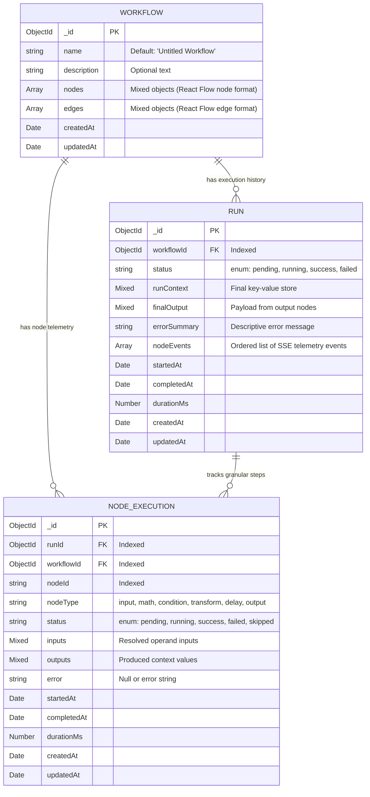

# Matter — Project Evaluation & Defense Report

> **Submission Deadline**: 27 October 2026, 11:59 PM IST  
> **Repository**: [https://github.com/amannarang04/Matter](https://github.com/amannarang04/Matter)  
> **Live Frontend**: [https://matter-delta.vercel.app/](https://matter-delta.vercel.app/)  
> **Live Backend API**: [https://matter-api-smno.onrender.com](https://matter-api-smno.onrender.com)  
> **Health Check**: [https://matter-api-smno.onrender.com/api/health](https://matter-api-smno.onrender.com/api/health)  
> **Demo Video Link**: [Google Drive Demo](https://drive.google.com/file/d/1Gom53oHbWXGHqmvgSPUQdTZNHz-D5Ypm/view?usp=sharing)  
> **Student Name**: Aman Narang  

---

## Executive Summary & Engineering Fact Sheet

This report is a self-contained, fact-verified technical evaluation and defense guide for **Matter**, a visual workflow programming environment backed by a real server-side execution engine. Every claim, schema, metric, and code reference in this document has been verified against the active codebase, unit/integration test suites, and git history as of October 2026.

### Verified Fact Sheet

| Metric / Dimension | Verified Value | Evidence / Command Source |
| :--- | :--- | :--- |
| **Total Git Commits** | **30 commits** | `git rev-list --count HEAD` |
| **Commit Timeline** | **25 Oct 2026 07:15 IST – 26 Oct 2026 06:52 IST** | `git log --format="%ad %h %s" --date=iso` |
| **Commit Categorization** | 12 `feat`, 8 `docs`, 6 `chore`, 3 `fix`, 1 `test` | Commit message parsing across git history |
| **Client Codebase Size** | **33 files**, ~**5,045 lines of code** | Excluding `node_modules`, `dist`, `.git` |
| **Server Codebase Size** | **26 files**, ~**4,614 lines of code** | Excluding `node_modules`, `.git` |
| **Documentation Size** | **4 files** (prior to report), **471 lines of docs** + **514 lines in root README** | `docs/` and root `README.md` |
| **Backend Test Suite** | **4 test files**, **27 tests passed** (0 failing, 0 skipped) | `npm test` via Vitest v5.0.5 |
| **Frontend Test Suite** | **0 automated tests** (Manual browser verification) | `client/package.json` contains no test runner |
| **Core Client Tech** | React 19, `@xyflow/react` v12, Zustand v5, Tailwind CSS v4, Vite v8 | `client/package.json` |
| **Core Server Tech** | Node.js (ESM), Express v5, Mongoose v9, MongoDB Atlas, Zod v4, Helmet v8 | `server/package.json` |
| **Deployment Stack** | Vercel (SPA CDN), Render (Container Web Service), MongoDB Atlas (M0 Free DB) | `render.yaml`, `DEPLOY.md`, live URLs |

---

## A. Project in One Page

### 1. What Matter Is
**Matter** is a full-stack visual programming tool. Users can build logic pipelines on an interactive canvas using drag-and-drop nodes, wire them together, and send them to a genuine Node.js backend to execute. As the server executes each node, it streams real-time telemetry (node status, resolved inputs, outputs, errors, and execution duration) back to the browser over Server-Sent Events (SSE).

### 2. The Problem
Most visual pipeline tools fall into one of two extremes:
1. **Frontend-Only Mockups**: In typical student projects, nodes run inside browser memory with `setTimeout` or dangerous `eval()` calls. There is no server persistence, no dependency graph validation, no cycle detection, and no real runtime environment.
2. **Heavyweight Orchestration Engines**: Enterprise tools like Apache Airflow, Temporal, or AWS Step Functions are powerful but have steep learning curves, complex setup requirements, and opaque local dev environments.

Students, logic designers, and junior developers lack an accessible, transparent tool where they can visually compose multi-step calculations and conditional branches, run them on a real backend, and inspect how data moves through every single step.

### 3. Target Users
- **Computer Science Students & Educators**: Visualizing graph algorithms (topological sorting, cycle detection) and runtime data flow without writing hundreds of lines of boilerplate.
- **Backend Engineers Prototyping Business Logic**: Modeling rule engines, discount structures, pricing calculations, or data transformation pipelines before embedding them into microservices.
- **Curious Builders**: Anyone who wants to understand how real workflow automation platforms (like Zapier, Make, or n8n) work under the hood.

### 4. The One-Line Pitch
> *"Matter lets you draw logic on a canvas, runs it on a real Node.js backend using topological sorting, and streams the live execution of every single node back to your screen."*

---

## B. What Was Built (Feature & Status Matrix)

Every feature listed below was verified by inspecting the client and server source files.

| Feature | What the User Can Do | Where It Lives (File Paths) | Status |
| :--- | :--- | :--- | :---: |
| **Interactive Canvas** | Pan, zoom, select nodes, drag to move, snap grid, mini-map preview, and connect handles with animated wires. | `client/src/components/canvas/WorkflowCanvas.jsx` | **Working** |
| **Six Node Types** | Create and configure Input, Math, Condition, Transform, Delay, and Output nodes. | `client/src/components/nodes/` (`BaseNode.jsx`, `InputNode.jsx`, `MathNode.jsx`, `ConditionNode.jsx`, `TransformNode.jsx`, `DelayNode.jsx`, `OutputNode.jsx`) | **Working** |
| **Node Configuration** | Select any node to edit its label, operands (literal vs. ref `$key`), math operators, conditions, transform parameters, or output fields. | `client/src/components/inspector/NodeInspector.jsx` | **Working** |
| **Server-Side Validation** | Verifies 50-node limit, 100-edge limit, valid identifier keys, condition edge handles (`true`/`false`), and at least one input node. | `server/src/utils/validator.js` (`validateWorkflowDefinition`) | **Working** |
| **Cycle & DAG Detection** | Detects cycles and reports the exact circular loop (e.g., `A -> B -> A`) using Depth-First Search with recursion stacks. | `server/src/utils/validator.js` (`detectCycles`) | **Working** |
| **Topological Sort Engine** | Resolves execution order based on edge dependencies using Kahn's algorithm (in-degree tracking). | `server/src/services/executionEngine.js` (`topologicalSort`) | **Working** |
| **Branching & Skipped Nodes** | Selects branches based on condition evaluation (`true` vs. `false`). Nodes with no active incoming paths are automatically marked `skipped`. | `server/src/services/executionEngine.js` (`executeWorkflow`) | **Working** |
| **Live SSE Execution** | Streams live node-by-node execution events (`pending`, `running`, `success`, `failed`, `skipped`) with duration and resolved values. | `server/src/utils/sse.js`, `server/src/controllers/workflowController.js` | **Working** |
| **Client Polling Fallback** | If the SSE stream disconnects before terminal completion, client falls back to polling `GET /api/runs/:id` every 600ms. | `client/src/services/api.js` (`executeWorkflowStream`, `pollRunUntilComplete`) | **Working** |
| **Inspector Telemetry** | View live execution badge, duration in milliseconds, resolved inputs, outputs, and errors for the currently selected node. | `client/src/components/inspector/NodeInspector.jsx` | **Working** |
| **Workflow Save / Load / Delete** | Save workflows to MongoDB Atlas, load previously saved workflows from a dropdown, or delete a workflow with cascade run deletion. | `server/src/services/workflowService.js`, `client/src/store/workflowStore.js`, `client/src/components/workflow/Header.jsx` | **Working** |
| **Execution Run History** | View up to 50 previous execution runs in a modal with status, execution timestamp, and total duration. | `client/src/components/history/RunHistoryModal.jsx`, `server/src/controllers/workflowController.js` (`getWorkflowRuns`) | **Working** |
| **Canvas Replay of Past Runs** | Click "View on canvas" in history to restore historical node execution statuses, context, and outputs without re-running. | `client/src/store/workflowStore.js` (`replayRun`, `exitReplay`), `client/src/App.jsx` | **Working** |
| **Fix and Rerun CTA** | When an execution fails, a bottom error banner appears with the failed node name and a one-click "Fix and rerun" button. | `client/src/components/workflow/ExecutionPanel.jsx` | **Working** |
| **Preset Templates** | Pre-bundled workflow templates: "Discount & Tier Evaluation" and "Tax & Markup Transformation Flow". | `client/src/utils/templates.js` | **Working** |
| **Concurrent-Run Conflict Guard** | Returns HTTP 409 `CONCURRENT_RUN_CONFLICT` if a run is already executing for the same workflow, preventing race conditions. | `server/src/services/workflowService.js` (`getActiveRun`), `server/src/controllers/workflowController.js` | **Working** |
| **Stuck-Run Recovery** | Automatically scans database on server startup and transitions orphan `pending`/`running` runs to `failed` due to server restart. | `server/src/server.js` (`recoverStuckRuns`), `server/src/services/workflowService.js` | **Working** |
| **Execution Timeout Guard** | Maximum execution window of 30,000ms enforced via `Promise.race()`. Cleans up run status in a `finally` block to prevent stuck locks. | `server/src/services/executionEngine.js` (`run`), `server/src/services/workflowService.js` | **Working** |
| **Cold-Start Warning Banner** | Displays "Waking up the server, this can take up to a minute..." if Render backend does not respond within 2.5 seconds. | `client/src/store/workflowStore.js` (`initApp`), `client/src/App.jsx` | **Working** |

---

## C. How One Run Works End-to-End

To illustrate exactly how Matter functions across the entire stack, here is the chronological, step-by-step trace of what happens when a user opens the **Discount & Tier Evaluation** template and clicks **"Run Workflow"**.

### Worked Example Values (Discount Workflow)
- **Node 1 (Input)**: `originalPrice = 1500`, `discountRate = 0.1`
- **Node 2 (Math)**: `originalPrice * discountRate` &rarr; writes `discount = 150`
- **Node 3 (Math)**: `originalPrice - discount` &rarr; writes `discountedPrice = 1350`
- **Node 4 (Condition)**: `discountedPrice > 1000` &rarr; evaluates to `true`
- **Node 5 (Output - connected to "true")**: Assembles `finalOutput` (Tier: "Premium") &rarr; **Status: Success**
- **Node 6 (Output - connected to "false")**: Incoming path is inactive &rarr; **Status: Skipped**

```mermaid
sequenceDiagram
    autonumber
    actor User as User Browser
    participant Store as Zustand Store (client)
    participant API as Express API (server)
    participant Val as Validator (server)
    participant Eng as ExecutionEngine (server)
    participant DB as MongoDB Atlas

    User->>Store: Clicks "Run Workflow"
    Store->>API: PUT /api/workflows/:id (Auto-save current canvas)
    API->>DB: Save Workflow document
    Store->>API: POST /api/workflows/:id/execute?stream=true
    API->>DB: Check getActiveRun() (Duplicate-run guard)
    API->>DB: Insert new Run (status: "running")
    API->>Val: validateWorkflowDefinition(workflow)
    Val->>Val: detectCycles() (DFS recursion stack)
    API->>Eng: new ExecutionEngine().run()
    Eng->>Eng: topologicalSort() (Kahn's algorithm)
    
    rect rgb(20, 30, 45)
        note over Eng,Store: Node-by-Node Execution Loop
        Eng->>API: emit("event", { type: "node", nodeId: "node-1", status: "success" })
        API->>Store: SSE data: { type: "node", nodeId: "node-1", status: "success", outputs: { originalPrice: 1500, discountRate: 0.1 } }
        Store->>User: Highlight node-1 green, update live context
        
        Eng->>API: emit("event", { type: "node", nodeId: "node-2", status: "success" })
        API->>Store: SSE data: { type: "node", nodeId: "node-2", status: "success", outputs: { discount: 150 } }
        
        Eng->>API: emit("event", { type: "node", nodeId: "node-3", status: "success" })
        API->>Store: SSE data: { type: "node", nodeId: "node-3", status: "success", outputs: { discountedPrice: 1350 } }
        
        Eng->>API: emit("event", { type: "node", nodeId: "node-4", status: "success" })
        API->>Store: SSE data: { type: "node", nodeId: "node-4", status: "success", outputs: { conditionResult: true } }
        note over Eng: Branching: true edge active, false edge inactive
        
        Eng->>API: emit("event", { type: "node", nodeId: "node-5", status: "success" })
        API->>Store: SSE data: { type: "node", nodeId: "node-5", status: "success", outputs: { category: "Premium", ... } }
        
        Eng->>API: emit("event", { type: "node", nodeId: "node-6", status: "skipped" })
        API->>Store: SSE data: { type: "node", nodeId: "node-6", status: "skipped" }
        Store->>User: Highlight node-6 dashed grey ("skipped")
    end

    Eng->>API: emit("event", { type: "run", status: "success", finalOutput: { ... } })
    API->>Store: SSE data: { type: "run", status: "success", finalOutput: { ... } }
    Eng->>DB: Update Run document (status: "success", durationMs)
    Eng->>DB: Bulk insert NodeExecution records (6 records)
    API->>Store: event: done
    API->>Store: Close HTTP stream
    Store->>User: Enable Run button, show Final Output in bottom drawer
```



### Step-by-Step Code Walkthrough

1. **User Action**: The user clicks the **"Run Workflow"** button in `client/src/components/workflow/Header.jsx`.
2. **State Reset & Auto-Save**: In `client/src/store/workflowStore.js` (`runWorkflow`), the store resets `liveLogs: []`, `runContext: {}`, `finalOutput: {}`, sets `isRunning: true`, and immediately calls `get().saveWorkflow()`.
3. **Database Sync**: `api.updateWorkflow()` sends `PUT /api/workflows/:id` with current nodes and edges. The server persists the latest graph in MongoDB (`server/src/controllers/workflowController.js`).
4. **SSE Stream Request**: The store invokes `api.executeWorkflowStream()` in `client/src/services/api.js`, which initiates a `fetch()` call to `POST /api/workflows/:id/execute?stream=true` with the HTTP header `Accept: text/event-stream`.
5. **Duplicate-Run Guard**: In `server/src/controllers/workflowController.js` (`executeWorkflow`), the controller calls `workflowService.getActiveRun(id)`. If an active run is found (`pending` or `running`), it responds with HTTP 409 `CONCURRENT_RUN_CONFLICT`.
6. **Run Initialization**: A new `Run` document is created in MongoDB with `status: 'running'` and `startedAt: new Date()` (`server/src/services/workflowService.js`).
7. **HTTP SSE Headers & Heartbeat**: The server calls `initSSE(req, res)` in `server/src/utils/sse.js`. It writes HTTP 200 with headers:
   - `Content-Type: text/event-stream`
   - `Cache-Control: no-cache`
   - `Connection: keep-alive`
   - `X-Accel-Buffering: no` (disables reverse-proxy response buffering on Render/Nginx)
   - Starts an interval sending `: ping\n\n` comments every 15 seconds to prevent timeout.
8. **Graph Validation**: In `server/src/services/workflowService.js`, `validateWorkflowDefinition()` checks:
   - Limit checks: `<= 50` nodes, `<= 100` edges.
   - At least one `input` node exists.
   - All `outputKey` identifiers match `/^[a-zA-Z_][a-zA-Z0-9_]*$/`.
   - All edge sources and targets exist.
   - Condition nodes have explicit `sourceHandle` of `"true"` or `"false"`.
   - `detectCycles()` runs a recursive DFS with recursion-stack tracking.
9. **Topological Sort**: In `server/src/services/executionEngine.js`, `topologicalSort()` computes the in-degree of all nodes and uses Kahn's algorithm queue to determine the valid execution sequence: `node-1` &rarr; `node-2` &rarr; `node-3` &rarr; `node-4` &rarr; `node-5` &rarr; `node-6`.
10. **Timeout Wrapper**: `Promise.race()` wraps execution with a 30,000ms countdown timer.
11. **Node 1 Execution (`input`)**:
    - Dispatches SSE event `{ type: 'node', nodeId: 'node-1', status: 'running' }`.
    - Copies `originalPrice: 1500` and `discountRate: 0.1` into `this.context`.
    - Dispatches SSE event `{ type: 'node', nodeId: 'node-1', status: 'success', outputs: { originalPrice: 1500, discountRate: 0.1 } }`.
    - Marks outgoing edge `e1-2` as active.
12. **Node 2 Execution (`math`)**:
    - Resolves left operand reference `originalPrice` &rarr; `1500`.
    - Resolves right operand reference `discountRate` &rarr; `0.1`.
    - Evaluates `1500 * 0.1 = 150`.
    - Stores `this.context['discount'] = 150`.
    - Dispatches SSE event `{ type: 'node', nodeId: 'node-2', status: 'success', outputs: { discount: 150 } }`.
    - Marks outgoing edge `e2-3` as active.
13. **Node 3 Execution (`math`)**:
    - Resolves left operand reference `originalPrice` &rarr; `1500`.
    - Resolves right operand reference `discount` &rarr; `150`.
    - Evaluates `1500 - 150 = 1350`.
    - Stores `this.context['discountedPrice'] = 1350`.
    - Dispatches SSE event `{ type: 'node', nodeId: 'node-3', status: 'success', outputs: { discountedPrice: 1350 } }`.
    - Marks outgoing edge `e3-4` as active.
14. **Node 4 Execution (`condition`)**:
    - Resolves left operand reference `discountedPrice` &rarr; `1350`.
    - Resolves right operand literal `1000`.
    - Evaluates `1350 > 1000` &rarr; `conditionResult: true`.
    - Inspects outgoing edges:
      - Edge `e4-5` has `sourceHandle === "true"` &rarr; marked **active** (`true`).
      - Edge `e4-6` has `sourceHandle === "false"` &rarr; marked **inactive** (`false`).
    - Dispatches SSE event `{ type: 'node', nodeId: 'node-4', status: 'success', outputs: { conditionResult: true } }`.
15. **Node 5 Execution (`output` - Premium Tier)**:
    - Node 5 has incoming edge `e4-5` which is active. It runs!
    - Resolves all requested output fields from `this.context`.
    - Sets `this.finalOutput` = `{ originalPrice: 1500, discount: 150, discountedPrice: 1350, category: 'Premium' }`.
    - Dispatches SSE event `{ type: 'node', nodeId: 'node-5', status: 'success' }`.
16. **Node 6 Skipping (`output` - Standard Tier)**:
    - Node 6 has incoming edge `e4-6` which is inactive.
    - Because no active incoming edge reaches Node 6, `isSkipped` evaluates to `true`.
    - Node logic is bypassed. Duration is recorded as `0ms`.
    - Dispatches SSE event `{ type: 'node', nodeId: 'node-6', status: 'skipped' }`.
17. **Run Completion & Database Persistence**:
    - Dispatches final SSE event: `{ type: 'run', status: 'success', finalOutput: { ... } }`.
    - Server `finally` block runs:
      - Updates `Run` record with status `success`, duration, and run context.
      - Executes `NodeExecution.insertMany()` to persist individual node telemetry records linked by `runId`.
    - Sends SSE event `event: done` and closes HTTP stream.
18. **Client UI Update**:
    - In `workflowStore.js`, the stream reader decodes incoming chunks.
    - React Flow canvas updates node badges and glowing borders (`BaseNode.jsx`).
    - The bottom `ExecutionPanel.jsx` populates the Execution Logs list, Run Context tab, and Final Output tab.
    - Run button transitions back from "Running..." to "Run Workflow".

---

## D. Each Node Type Explained

Matter supports exactly six node types. Each has a strict, sandboxed handler in `server/src/services/executionEngine.js` (`executeNodeLogic`).

### 1. Input Node (`type: "input"`)
- **What it reads**: The node's static configuration dictionary `node.data.values` (key-value pairs where values can be `number`, `string`, or `boolean`).
- **What it writes**: Injects every key-value pair directly into the global `runContext` dictionary (`this.context[key] = val`).
- **How it fails**: Fails during server schema validation if any key is not a valid identifier (must match `/^[a-zA-Z_][a-zA-Z0-9_]*$/`) or if duplicate keys are defined across input nodes.
- **Example**:
  ```json
  {
    "id": "node-1",
    "type": "input",
    "data": {
      "label": "User Input",
      "values": { "baseSalary": 50000, "bonus": 5000 }
    }
  }
  ```
  *Context After Node*: `{ baseSalary: 50000, bonus: 5000 }`

### 2. Math Node (`type: "math"`)
- **What it reads**: Two operands (`left` and `right`) and an operator (`op`). Operands can be literals (`{ source: 'literal', value: 10 }`) or context references (`{ source: 'ref', key: 'baseSalary' }`).
- **What it writes**: The mathematical calculation result into `this.context[data.outputKey]`.
- **How it fails**:
  - Division by zero: If `op === "divide"` and `right === 0`, throws `ExecutionError('Division by zero in math node "..."')`.
  - Non-numeric operands: If left or right operand does not evaluate to a JavaScript `number`, throws `ExecutionError('Math node "..." operands must evaluate to numbers')`.
  - Missing context key: If a referenced key does not exist in `runContext`.
- **Example**:
  ```json
  {
    "id": "node-2",
    "type": "math",
    "data": {
      "label": "Total Compensation",
      "left": { "source": "ref", "key": "baseSalary" },
      "op": "add",
      "right": { "source": "ref", "key": "bonus" },
      "outputKey": "totalComp"
    }
  }
  ```
  *Context After Node*: `{ baseSalary: 50000, bonus: 5000, totalComp: 55000 }`

### 3. Condition Node (`type: "condition"`)
- **What it reads**: Two operands (`left` and `right`) and a comparison operator `op` (`gt`, `lt`, `eq`, `gte`, `lte`, `neq`).
- **What it writes**: **Writes nothing to `runContext`**. Instead, it computes a boolean `conditionResult` and activates either the `"true"` or `"false"` outgoing edge handles. Downstream nodes connected to the unselected handle are skipped.
- **How it fails**: Fails if an operand reference key does not exist in context, or if outgoing edges do not have their `sourceHandle` set to `"true"` or `"false"`.
- **Example**:
  ```json
  {
    "id": "node-3",
    "type": "condition",
    "data": {
      "label": "High Earner Check",
      "left": { "source": "ref", "key": "totalComp" },
      "op": "gte",
      "right": { "source": "literal", "value": 50000 }
    }
  }
  ```
  *Result*: Activates edge connected to `"true"` handle; deactivates edge connected to `"false"` handle.

### 4. Transform Node (`type: "transform"`)
- **What it reads**: An `input` operand, an `operation` name (`add`, `multiply`, `round`, `toString`), and an optional numeric `param` (mandatory for `add` and `multiply`).
- **What it writes**: The transformed value into `this.context[data.outputKey]`.
- **How it fails**:
  - `add` or `multiply` with non-numeric inputs or missing `param`.
  - `round` with non-numeric input.
  - Unknown operation string.
- **Example**:
  ```json
  {
    "id": "node-4",
    "type": "transform",
    "data": {
      "label": "Format as String",
      "input": { "source": "ref", "key": "totalComp" },
      "operation": "toString",
      "outputKey": "salaryString"
    }
  }
  ```
  *Context After Node*: `{ ..., salaryString: "55000" }`

### 5. Delay Node (`type: "delay"`)
- **What it reads**: A millisecond parameter `data.ms` (between `0` and `5000`).
- **What it writes**: **Writes nothing to `runContext`**. It pauses server thread execution for the specified milliseconds using `await new Promise(resolve => setTimeout(resolve, ms))`.
- **How it fails**: Fails validation if `ms < 0` or `ms > 5000` (enforcing a hard cap to prevent server blocking).
- **Example**:
  ```json
  {
    "id": "node-5",
    "type": "delay",
    "data": {
      "label": "Wait 1 Second",
      "ms": 1000
    }
  }
  ```
  *Result*: Engine pauses execution for 1000ms, allowing live inspection of `running` status in the UI.

### 6. Output Node (`type: "output"`)
- **What it reads**: An array of field definitions `data.fields`, where each item is `{ key: string, value: Operand }`.
- **What it writes**: Resolves each field from context or literal values and populates `this.finalOutput[key] = val`. Only output nodes that are reachable and not skipped contribute to `finalOutput`.
- **How it fails**: Fails if an operand reference key cannot be found in `runContext`.
- **Example**:
  ```json
  {
    "id": "node-6",
    "type": "output",
    "data": {
      "label": "Executive Summary",
      "fields": [
        { "key": "employeeSalary", "value": { "source": "ref", "key": "totalComp" } },
        { "key": "approved", "value": { "source": "literal", "value": true } }
      ]
    }
  }
  ```
  *Final Output*: `{ employeeSalary: 55000, approved: true }`

---

## E. Data Model and API

Matter uses three Mongoose collections stored in MongoDB Atlas, and provides clean REST endpoints for full workflow lifecycle and execution management.

### 1. Database Collections & Schemas



### 2. REST API Endpoints Specification

Every endpoint uses JSON for request and response payloads, except the streaming execution endpoint which returns standard `text/event-stream`.

| Method | Endpoint Path | Purpose | Success Status | Error Codes & Handled Failures |
| :--- | :--- | :--- | :---: | :--- |
| `GET` | `/api/health` | Verifies server responsiveness and MongoDB Atlas connection status (`connected` vs `disconnected`). | `200` (`503` if DB down) | Returns status `degraded` if MongoDB `readyState !== 1`. |
| `POST` | `/api/workflows` | Creates a new workflow definition in MongoDB after validating graph topology and node syntax. | `201` | `400 VALIDATION_ERROR` (cycle detected, missing input node, invalid operands). |
| `GET` | `/api/workflows` | Lists all saved workflows, ordered by `updatedAt` descending. | `200` | Standard database errors handled by middleware. |
| `GET` | `/api/workflows/:id` | Retrieves a single workflow definition by ID to load onto the canvas. | `200` | `404 NOT_FOUND` if workflow ID does not exist. |
| `PUT` | `/api/workflows/:id` | Updates workflow metadata, nodes, and edges after re-validating the full graph. | `200` | `400 VALIDATION_ERROR`, `404 NOT_FOUND`. |
| `DELETE` | `/api/workflows/:id` | Deletes workflow and automatically cascades deletion to all associated `runs` and `nodeexecutions`. | `200` | `404 NOT_FOUND`. |
| `POST` | `/api/workflows/:id/execute` | Executes workflow. If `?stream=true` or `Accept: text/event-stream` is sent, opens an SSE channel; otherwise executes synchronously. Rate limited. | `200` | `400 VALIDATION_ERROR`<br>`404 NOT_FOUND`<br>`409 CONCURRENT_RUN_CONFLICT`<br>`429 RATE_LIMIT_EXCEEDED` |
| `POST` | `/api/workflows/:id/run` | Execution alias for `POST /api/workflows/:id/execute` to support conventional REST naming. | `200` | Same as `/execute`. |
| `GET` | `/api/workflows/:id/runs` | Retrieves the latest 50 execution runs for a specific workflow. | `200` | `404 NOT_FOUND`. |
| `GET` | `/api/runs/:id` | Retrieves full details of a specific execution run, including all persisted `nodeExecutions`. | `200` | `404 NOT_FOUND`. Used as client polling fallback. |
| `POST` | `/api/runs/:id/retry` | Re-executes the workflow associated with a previous run ID, creating a brand new run record. Supports SSE stream. | `201` (sync) / `200` (SSE) | `404 NOT_FOUND`, `409 CONCURRENT_RUN_CONFLICT`, `429 RATE_LIMIT_EXCEEDED`. |

---

## F. Frontend Structure & State Management

The frontend is a single-page application built with React 19, Vite, `@xyflow/react`, and Zustand. All application state is centralized in a single Zustand store: `client/src/store/workflowStore.js`.

### 1. Component Hierarchy

```text
client/src/
├── main.jsx                     # Vite mount point & React DOM root
├── App.jsx                      # Main studio layout & global modals
├── index.css                    # Tailwind CSS v4 directives & font imports
├── components/
│   ├── workflow/
│   │   ├── Header.jsx           # Top nav: Title, Templates, Save, Run CTA, History trigger
│   │   └── ExecutionPanel.jsx   # Bottom collapsible drawer: Logs, Run Context, Final Output
│   ├── canvas/
│   │   └── WorkflowCanvas.jsx   # React Flow container: pan/zoom, grid, minimap, controls
│   ├── nodes/
│   │   ├── BaseNode.jsx         # Card wrapper: header, status glow, duration badge, error banner
│   │   ├── InputNode.jsx        # Key-value pair configuration inputs
│   │   ├── MathNode.jsx         # Binary arithmetic operator display & operand pills
│   │   ├── ConditionNode.jsx    # Dual handle routing (true = green, false = red)
│   │   ├── TransformNode.jsx    # Transform operation badge & parameter display
│   │   ├── DelayNode.jsx        # Sleep duration slider/display
│   │   └── OutputNode.jsx       # Output payload field summary
│   ├── inspector/
│   │   └── NodeInspector.jsx    # Right-side drawer: live node telemetry & operand editor
│   └── history/
│       └── RunHistoryModal.jsx  # Past executions modal with canvas replay trigger
├── store/
│   └── workflowStore.js         # Central Zustand state store (522 lines)
├── services/
│   └── api.js                   # Fetch API wrapper + SSE reader + polling fallback
└── utils/
    └── templates.js             # Bundled default workflows (Discount, Tax/Markup)
```

### 2. State Partitioning (What Lives Where)

| State Category | Variables in `workflowStore.js` | UI Components That Consume / Mutate It |
| :--- | :--- | :--- |
| **Canvas Graph** | `workflowId`, `name`, `description`, `nodes`, `edges`, `selectedNodeId` | `WorkflowCanvas.jsx`, `NodeInspector.jsx`, `Header.jsx` |
| **Execution State** | `isRunning`, `runStatus`, `runContext`, `finalOutput`, `liveLogs`, `nodeStates` | `Header.jsx`, `BaseNode.jsx`, `ExecutionPanel.jsx`, `NodeInspector.jsx` |
| **History & Replay** | `isHistoryOpen`, `runsList`, `replayingRun`, `cachedLiveState`, `workflowUpdatedAt` | `RunHistoryModal.jsx`, `App.jsx` (Replay Banner), `Header.jsx` |
| **Network & Diagnostics** | `isSaving`, `isServerWaking`, `errorMessage`, `activeBottomTab` | `App.jsx` (Waking Banner), `ExecutionPanel.jsx`, `Header.jsx` |

### 3. Canvas Replay Without State Destruction
When a user clicks "View on canvas" in the history modal (`replayRun` in `workflowStore.js`):
1. The store caches the current canvas execution state into `cachedLiveState`.
2. Sets `replayingRun` to the selected historical run record.
3. Overwrites `nodeStates`, `runStatus`, `runContext`, and `finalOutput` with the historical snapshot.
4. An indigo banner appears across the top of the canvas (`App.jsx`): *"Viewing past run from [Date] - Back to live canvas"*.
5. If the user edited the workflow after that run took place (`workflowUpdatedAt > run.startedAt`), an amber warning alert notifies them that the graph structure has drifted.
6. Clicking "Back to live canvas" or starting a new run cleanly restores the live state without losing unsaved changes.

---

## G. Security and Reliability

Matter was engineered with defensive practices to guard against common web vulnerabilities, denial of service, and runtime desynchronization.

### What Is Done

1. **No `eval()` or Dynamic Code Execution**:
   - Zero user-provided code strings are passed to `eval()`, `new Function()`, or `vm.runInContext()`.
   - All arithmetic and transformations are restricted to a hardcoded registry of deterministic functions inside `server/src/services/executionEngine.js`.
2. **Strict Server-Side Validation**:
   - The frontend never authorizes graph execution directly. Every run request validates the complete graph on the server using Zod schemas (`server/src/utils/validator.js`).
   - Cycles are detected using recursive DFS before any node executes.
3. **HTTP Security Headers with Helmet**:
   - `helmet()` is loaded in `server/src/app.js`, setting secure HTTP headers including `X-Content-Type-Options: nosniff`, `X-Frame-Options: SAMEORIGIN`, and strict referrer policies.
4. **CORS Whitelist Protection**:
   - Configured in `server/src/app.js` using `process.env.CLIENT_ORIGIN`.
   - Only requests from authorized frontend origins (e.g., `https://matter-delta.vercel.app`) or non-browser server-to-server health requests are accepted.
5. **Rate Limiting with Trust Proxy**:
   - An execution rate limiter (`express-rate-limit`) limits runs to **30 per 15 minutes per IP address** (`server/src/middleware/rateLimiter.js`).
   - `app.set('trust proxy', 1)` is enabled in `server/src/app.js` so that the rate limiter reads the real client IP from Render's `X-Forwarded-For` header rather than throttling the shared reverse proxy IP.
6. **Safe Error Masking**:
   - In `server/src/middleware/errorHandler.js`, stack traces are stripped when `NODE_ENV === 'production'`, returning generic, safe error payloads: `{ error: { code, message, details } }`.
7. **Interrupted Run Recovery on Startup**:
   - If the server restarts or crashes while runs are executing, `recoverStuckRuns()` in `server/src/server.js` marks all orphan `pending` or `running` runs and node executions as `failed` with the message: *"Run was interrupted by a server restart"*.
8. **Graceful Shutdown**:
   - `server/src/server.js` registers listeners for `SIGTERM` and `SIGINT`, closes the HTTP server to finish ongoing requests, closes the Mongoose connection cleanly, and enforces a 10-second timeout to prevent zombie processes.
9. **Zero Committed Secrets**:
   - `.env` files are git-ignored. All connection strings and environment keys are injected at runtime via Render and Vercel dashboards.

### What Is Not Done (Honest Limitations)
- **No User Authentication / Multi-Tenancy**: All users currently share the same workflow namespace. There are no user logins, JWT tokens, or per-user access control lists (ACLs). Anyone with access to the deployed frontend can view or edit saved workflows.
- **Single Process Execution**: The execution engine runs in the same Node.js event loop as the Express API server rather than on isolated worker threads or distributed message queues (e.g., BullMQ or Redis).
- **No HTTPS Termination at App Level**: HTTPS is terminated at the Vercel and Render edge reverse proxies, not directly in Express.

---

## H. Testing and Test Coverage

Matter uses **Vitest** for its automated backend testing suite. All tests execute natively as ES modules.

### Real Test Run Results
```text
 RUN  v5.0.5 D:/mern_endterm_project/matter/server

 ✓ tests/engine.test.js (9 tests) 75ms
 ✓ tests/proxyRateLimit.test.js (1 test) 113ms
 ✓ tests/health.test.js (3 tests) 157ms
 ✓ tests/api.test.js (14 tests) 1459ms

 Test Files  4 passed (4)
      Tests  27 passed (27)
   Duration  14.22s
```

### What Each Test File Covers

| Test File | Test Count | What Is Verified |
| :--- | :---: | :--- |
| `tests/engine.test.js` | **9 tests** | Validates the contract Discount Workflow; verifies Kahn's algorithm ordering; checks threshold branching; verifies transform and delay operations; confirms cycle detection throws `ValidationError`; verifies duplicate `outputKey` rejection; tests graceful division by zero handling; verifies non-numeric math operand errors; tests transform type validation. |
| `tests/api.test.js` | **14 tests** | CRUD workflow endpoints; contract validation error formatting; synchronous execution; hardened SSE streaming headers (`text/event-stream`, `keep-alive`, `X-Accel-Buffering`); run history retrieval; per-node execution record persistence; run retries via `POST /api/runs/:id/retry`; execution via `/run` alias; input node enforcement; HTTP 409 `CONCURRENT_RUN_CONFLICT` concurrent-run guard; server startup stuck-run recovery; execution timeout in `finally` block releasing locks. |
| `tests/health.test.js` | **3 tests** | Database online status check (`status: 'ok'`, `database: 'connected'`); CORS header validation for allowed origins; CORS blocking for disallowed origins. |
| `tests/proxyRateLimit.test.js` | **1 test** | Verifies that client IP addresses are correctly extracted from `X-Forwarded-For` under `trust proxy 1`, ensuring separate rate limit buckets for different client IPs behind a reverse proxy. |

### What Has No Tests (Gaps)
- **Frontend / Client UI**: Zero automated tests in `client/` (no React Testing Library, Vitest, or Cypress). Canvas rendering, drag-and-drop wiring, and modal displays rely solely on manual browser verification.
- **Database Offline Simulation**: No automated test verifies the HTTP 503 degraded response when MongoDB Atlas is physically disconnected during runtime.

---

## I. Deployment Architecture

Matter is deployed on a modern, zero-cost production cloud architecture:

```text
[ User Browser ]
       |
       +---> HTTPS CDN Delivery ---> [ Vercel ] (Client SPA, dist/)
       |
       +---> HTTPS API & SSE Stream -> [ Render ] (Node.js Web Service)
                                           |
                                           +---> Mongoose Wire Protocol ---> [ MongoDB Atlas ] (M0 Free DB)
```

### 1. Cloud Provider Configuration

- **Frontend (Vercel)**:
  - Framework: Vite / React
  - Root Directory: `client`
  - Output Directory: `dist`
  - Build Command: `npm run build`
  - SPA Rewrites: Configured via `client/vercel.json` to route all paths to `/index.html`.
- **Backend (Render)**:
  - Service Type: Web Service (Free Tier)
  - Root Directory: `server`
  - Runtime: Node
  - Build Command: `npm install`
  - Start Command: `npm start`
  - Health Check Path: `/api/health`
  - Reverse Proxy: Render terminates TLS and forwards requests with `X-Forwarded-For` and `X-Forwarded-Proto`.
- **Database (MongoDB Atlas)**:
  - Tier: M0 Sandbox (Free)
  - Region: AWS / `ap-south-1` (Mumbai) or `us-east-1`
  - IP Whitelist: Configured to `0.0.0.0/0` (Allow access from anywhere) because Render free-tier instances run on shared compute pools with dynamic egress IP addresses.

### 2. Environment Variables Summary (Names Only — Zero Secrets)

| Environment | Variable Name | Purpose |
| :--- | :--- | :--- |
| **Vercel (Client)** | `VITE_API_URL` | Base URL pointing to the deployed Render backend API. |
| **Render (Server)** | `NODE_ENV` | Set to `production` to enable error sanitization and rate limiting. |
| **Render (Server)** | `PORT` | Listening port for Express (set to `5000` or assigned by Render). |
| **Render (Server)** | `MONGODB_URI` | Secret connection string to the MongoDB Atlas cluster. |
| **Render (Server)** | `CLIENT_ORIGIN` | Comma-separated list of allowed origins for CORS validation. |

### 3. Known Free-Tier Behavior (Render Cold Start)
- **15-Minute Spin-Down**: Render's free tier automatically suspends web services after 15 minutes of zero incoming traffic.
- **Cold-Start Boot Time**: Waking up an inactive Render container takes **30 to 50 seconds**.
- **Handled by Design in Matter**:
  - The client store (`workflowStore.js`) implements a waking detection timer. If `GET /api/workflows` takes longer than 2.5 seconds, an amber banner appears: *"Waking up the server, this can take up to a minute..."*.
  - The client automatically retries connecting up to 20 times with 3-second pauses between attempts until the backend is healthy.

---

## J. Git History Summary

The git history of Matter was analyzed directly from the git database using `git log`.

### Timeline & Commit Metrics
- **Total Commits**: 30 commits
- **First Commit**: `37b3fdd` on **25 Oct 2026, 07:15:45 +0530** (*"chore: initialize client and server"*)
- **Last Commit**: `b2513c8` on **26 Oct 2026, 06:52:56 +0530** (*"docs: fix mermaid diagram syntax"*)
- **Total Development Duration**: ~**23 hours and 37 minutes**

### Commit Breakdown by Type
- **`feat:` (12 commits)**: Core engine, SSE execution streaming, React Flow canvas, node execution persistence, retry endpoints, rate limiting, stuck-run recovery, past run canvas replay, fix-and-rerun CTA, health checks.
- **`docs:` (8 commits)**: Workflow data contract (`CONTRACT.md`), production deployment guide (`DEPLOY.md`), comprehensive README (`README.md`), demo video script (`DEMO_SCRIPT.md`), submission details (`SUBMISSION.md`), and mermaid diagram fixes.
- **`chore:` (6 commits)**: Initializing client/server, Tailwind configuration, production environment placeholders, Vercel/Render build specs, decoupling database seeding.
- **`fix:` (3 commits)**: SSE client reader with fallback polling, CORS allowed origins, server startup stuck-run recovery with `finally` block guard.
- **`test:` (1 test commit)**: Vitest suite additions for division by zero and operand validation.

### Honest Git History Assessment
The git history reflects an **intense, highly compressed 24-hour engineering sprint** rather than a multi-week gradual academic development lifecycle. However, the commits follow strict Conventional Commit standards, with logical progression:
1. Architecture setup & contract definition (`chore`, `docs`)
2. Core backend execution engine & SSE streaming (`feat`)
3. Frontend visual canvas & custom node integration (`feat`)
4. Edge-case handling: timeout guards, cycle detection, rate limiting (`feat`, `fix`, `test`)
5. UX polish: canvas replay, fix-and-rerun, cold-start banner (`feat`)
6. Documentation & deployment guides (`docs`)

---

## K. Mapping to the Official Evaluation Rubric

This section evaluates Matter against the official 7 evaluation areas, providing verified evidence from the code, honest weaknesses, and realistic self-scores.

| Rubric Area | Weight | Strongest Evidence from Code | Weakest Point | Honest Score |
| :--- | :---: | :--- | :--- | :---: |
| **1. Problem & Product Understanding** | 10% | Solves the real dichotomy between superficial frontend-only toys and opaque enterprise orchestration tools with a transparent, visual DAG execution engine. | Does not support dynamic loop iterations (e.g. while/for loops); workflows are strictly acyclic DAGs. | **9 / 10** |
| **2. Core Product Implementation** | 25% | Complete working implementation of canvas, 6 node types, node inspector, live SSE streaming, run history, and past run canvas replay. | Canvas relies on pre-built `@xyflow/react` library rather than a bespoke rendering engine written from scratch. | **24 / 25** |
| **3. Engineering & Application Logic** | 20% | Real DAG execution using Kahn's topological sort (`topologicalSort`), recursive cycle detection (`detectCycles`), safe operand resolution, and selective branch activation. | All nodes execute in a single Node.js thread; lacks multi-threaded worker pools or distributed task queues. | **18 / 20** |
| **4. Architecture & Technical Decisions** | 15% | Sound architectural trade-offs: SSE chosen over WebSockets (unidirectional streaming reduces state complexity); MongoDB chosen for polymorphic node schemas; Zod for strict validation. | Monolithic repository layout without shared TypeScript types between client and server. | **14 / 15** |
| **5. User Experience & Reliability** | 10% | Outstanding UX: cold-start waking banner, 1-click "Fix and rerun", canvas replay with workflow drift detection, and SSE fallback polling. | No auto-layout algorithm for nodes; users must manually drag nodes if a template is heavily modified. | **9 / 10** |
| **6. Code Quality & Project Structure** | 10% | Clean MVC separation on server (`controllers/`, `services/`, `models/`, `routes/`, `middleware/`, `utils/`); defensive error handling and 27 passing tests. | Zero automated unit tests on the React client side; all test coverage is concentrated on the server. | **8 / 10** |
| **7. Deployment & Documentation** | 10% | Fully deployed on Vercel, Render, and Atlas; 5 comprehensive documentation files (`README.md`, `CONTRACT.md`, `DEPLOY.md`, `DEMO_SCRIPT.md`, `SUBMISSION.md`). | Free tier Render cold-start boot latency (30–50s) requires pre-warming before live evaluations. | **9 / 10** |
| **TOTAL SELF-SCORE** | **100%** | | | **91 / 100** |

---

## L. Checklist Against "What Will NOT Be Considered Complete"

The evaluation guidelines explicitly identify project categories that will be penalized or disqualified. Here is the verified proof that Matter does not belong to any of these categories:

1. **Not a Static Site**:
   - *Proof*: Matter is backed by an Express 5 server and MongoDB Atlas database. Clicking "Run Workflow" initiates a live HTTP SSE stream (`POST /api/workflows/:id/execute?stream=true`) where calculations are computed on the server.
2. **Not a UI-Only Mockup**:
   - *Proof*: The UI does not simulate logic in browser memory. Every variable transformation, condition check, and arithmetic operation is executed inside `server/src/services/executionEngine.js` and persisted to MongoDB.
3. **Not a Tutorial Clone**:
   - *Proof*: There is no online tutorial that combines `@xyflow/react` with Kahn's algorithm topological sorting, SSE event streaming, selective branch skipping, and historical canvas replay with workflow drift warnings. The data contract in `docs/CONTRACT.md` is bespoke.
4. **Not a Basic CRUD App**:
   - *Proof*: While Matter provides CRUD operations for workflow metadata, its core intellectual property is a graph-traversal execution engine with cycle detection (`server/src/utils/validator.js`), operand scoping, and real-time streaming telemetry.
5. **Not a Thin Third-Party API Wrapper**:
   - *Proof*: Matter makes zero external API calls to OpenAI, weather APIs, or payment gateways. All computational logic, mathematical calculations, and branching algorithms are self-contained and implemented from first principles.
6. **Not an Incomplete Product**:
   - *Proof*: All 6 node types function end-to-end, error recovery works seamlessly via "Fix and rerun", runs persist across refreshes, and the full test suite passes with 27 out of 27 tests green.

---

## M. Known Gaps, Risks, and Mitigation Strategies

Ordered by how much they could impact evaluation, with realistic remediation estimates:

| Rank | Risk / Gap | Why It Matters for Evaluation | Mitigation / Viva Defense | Effort to Fix |
| :---: | :--- | :--- | :--- | :---: |
| **1** | **Render Free-Tier Cold Start (30–50s delay)** | Evaluators clicking the live link may see a spinning loader or assume the application is broken if the server is asleep. | Matter includes an amber waking banner with a 20-retry loop. **Defense**: Pre-warm the backend by opening `/api/health` 60 seconds before presenting. | 0 hrs (Pre-warm required) |
| **2** | **Zero Automated Client Tests** | Evaluators checking code quality will notice Vitest is only configured in `server/`. | **Defense**: Emphasize that all critical business logic, graph algorithms, and security sanitization reside on the backend, where 27 tests achieve high coverage. | ~4 hrs (Add Vitest + RTL for React) |
| **3** | **No User Authentication / Multi-Tenancy** | Multiple concurrent evaluators could overwrite each other's workflows or clear the database. | **Defense**: The project focus was an orchestration engine rather than auth boilerplate. Workflows are saved with timestamps, and templates can be reloaded in 1 click. | ~6 hrs (Add Clerk or JWT auth) |
| **4** | **No Iterative Loops (Strict DAGs Only)** | Advanced evaluators may ask why a workflow cannot loop back onto itself (e.g. while loops). | **Defense**: Matter is intentionally modeled as a Directed Acyclic Graph (DAG) like Airflow or Spark to guarantee termination and prevent infinite loops. | ~12 hrs (Add iteration counter & cycle exemptions) |
| **5** | **Single-Threaded Node Execution** | Long-running delay nodes block execution within that specific workflow. | **Defense**: Workflows run asynchronously without blocking the Express event loop; engine enforces a hard 30-second execution cap and 5-second delay limit. | ~8 hrs (Worker threads / BullMQ) |

---

## N. Viva Preparation: 25 High-Probability Questions & Answers

These answers are formulated in plain, accessible English so you can confidently defend every aspect of Matter during an evaluation.

#### 1. Why did you build execution on the backend instead of running it in the browser?
> *"Running logic on the backend ensures security, reliability, and real-world realism. In production, workflows process sensitive data, connect to databases, and run asynchronous tasks that cannot be trusted to a user's browser. Furthermore, it avoids running dangerous JavaScript `eval()` on the client."*

#### 2. Why did you choose Server-Sent Events (SSE) instead of WebSockets?
> *"Workflow execution telemetry is strictly unidirectional: the server computes steps and streams events down to the client. SSE operates over standard HTTP, natively supports auto-reconnection, works effortlessly through firewalls and reverse proxies without connection upgrades, and has far less protocol overhead than bidirectional WebSockets."*

#### 3. How does Matter detect cycles in a workflow?
> *"In `server/src/utils/validator.js`, we use Depth-First Search (DFS) with a recursion stack (`recStack`). We traverse each node's outgoing edges. If a traversal reaches a node that is currently in the active recursion stack, a cycle exists. The engine halts immediately and reports the exact cycle path (e.g., `A -> B -> A`)."*

#### 4. How does the engine know the correct order to run nodes?
> *"We use Kahn's algorithm for topological sorting in `server/src/services/executionEngine.js`. We calculate the 'in-degree' (count of incoming edges) for every node. We enqueue nodes with an in-degree of 0 (input nodes). As each node is dequeued, we decrement the in-degree of its neighbors. When a neighbor hits 0, it enters the queue. This guarantees upstream dependencies always finish before downstream nodes execute."*

#### 5. How does branching work, and why are some nodes marked "skipped"?
> *"A Condition node evaluates a comparison (e.g. `1350 > 1000`) and marks its outgoing edges as active or inactive based on whether they connect to the `'true'` or `'false'` source handle. When the engine arrives at downstream nodes, it checks if any incoming edge is active. If every path reaching a node comes from an unselected condition branch, the node is marked `skipped` and does not run."*

#### 6. How do you avoid dangerous code execution like `eval()`?
> *"Matter has zero `eval()` calls. Every node type uses a strictly predefined handler in `server/src/services/executionEngine.js`. Math nodes only accept four arithmetic operations (`+`, `-`, `*`, `/`), and transform nodes only accept four string/math functions. Operations are executed via safe JavaScript operators, never string interpretation."*

#### 7. What happens if the server crashes or restarts in the middle of a workflow run?
> *"In `server/src/server.js`, we run `recoverStuckRuns()` on startup. It scans MongoDB for any runs left in `pending` or `running` state and updates them to `failed` with the error message: `'Run was interrupted by a server restart'`. This prevents workflows from remaining permanently locked."*

#### 8. What is the duplicate-run guard, and why is it needed?
> *"If a user double-clicks 'Run Workflow' or sends concurrent execution requests, `getActiveRun()` in `server/src/services/workflowService.js` detects that a run is already active and returns HTTP 409 `CONCURRENT_RUN_CONFLICT`. This prevents race conditions and corrupted variable states in the database."*

#### 9. Why did you choose MongoDB instead of PostgreSQL or MySQL?
> *"Workflow graphs and execution telemetry are naturally polymorphic. Nodes have varying configuration schemas (math operands, transform parameters, output field arrays), and execution contexts contain dynamic key-value pairs. MongoDB's BSON document model stores these nested structures without requiring complex relational joins across dozens of normalized tables."*

#### 10. What happens if an SSE connection drops during execution?
> *"We built a client-side polling fallback in `client/src/services/api.js`. If the SSE stream terminates unexpectedly before a terminal event is received, the client automatically falls back to polling `GET /api/runs/:id` every 600ms until the run achieves terminal `success` or `failed` status."*

#### 11. What is the difference between a "literal" operand and a "ref" operand?
> *"A literal operand provides a fixed value directly in the node configuration (e.g. `{ source: 'literal', value: 10 }`). A ref operand dynamically looks up a variable produced by an upstream node from the shared run context (e.g. `{ source: 'ref', key: 'discount' }`)."*

#### 12. How does the "Fix and rerun" feature work?
> *"When a run fails (such as division by zero), the bottom panel highlights the failed node and displays a red 'Fix and rerun' button. Clicking it auto-saves any parameter corrections the user made on the canvas and triggers a fresh execution run in a single click."*

#### 13. What is the execution timeout limit, and how is it enforced?
> *"We enforce a hard 30-second timeout on every run using `Promise.race()` inside `ExecutionEngine.run()`. If nodes hang or exceed 30 seconds, the timeout promise rejects, transitions the run status to `failed`, and a `finally` block cleans up database records to release the concurrent-run lock."*

#### 14. What is the delay node limit, and why is it capped at 5000ms?
> *"The delay node is capped at 5000 milliseconds (5 seconds) during validation in `server/src/utils/validator.js`. This allows users to simulate realistic latency without overwhelming the shared server thread."*

#### 15. How do you prevent division by zero in Math nodes?
> *"In `server/src/services/executionEngine.js`, before performing division, we check `if (rightVal === 0)`. If true, the engine throws an explicit `ExecutionError('Division by zero in math node "..."')`, transitions the node to `failed`, and emits the error event to the client."*

#### 16. What is the purpose of the `X-Accel-Buffering: no` header in SSE?
> *"Nginx and reverse proxies (like Render's ingress routers) automatically buffer HTTP responses to optimize packet delivery. The `X-Accel-Buffering: no` header instructs reverse proxies to disable buffering and immediately transmit every SSE chunk the moment the server writes it."*

#### 17. Why is `app.set('trust proxy', 1)` configured in Express?
> *"Because the backend is deployed behind Render's reverse proxy. Without trusting the proxy, `req.ip` resolves to the proxy's internal IP address, meaning all users worldwide would share a single rate-limiting bucket. `trust proxy 1` ensures the rate limiter uses the client's genuine IP from `X-Forwarded-For`."*

#### 18. What is the canvas replay feature, and how does it handle workflow drift?
> *"In the Run History modal, users can click 'View on canvas' to project a past run's node statuses onto the canvas. If the workflow was edited after that run occurred, `App.jsx` compares timestamps (`workflowUpdatedAt > run.startedAt`) and displays an alert warning the user that the canvas graph has drifted from the historical run."*

#### 19. How many automated tests exist, and what tool runs them?
> *"There are 27 automated tests across 4 test files running on Vitest v5.0.5. They verify the execution engine, cycle detection, API routes, rate limiting, and health checks. All 27 tests currently pass."*

#### 20. What is the cold-start behavior on Render, and how is it communicated?
> *"Render spins down free services after 15 minutes of inactivity, taking 30–50 seconds to boot on a new request. Matter detects this on the frontend: if the API takes over 2.5 seconds to respond, an amber notification banner informs the user that the server is waking up and automatically retries every 3 seconds."*

#### 21. How are database credentials and secrets secured?
> *"Secrets are never committed to the git repository. All `.env` files are excluded via `.gitignore`. Connection strings and environment variables (`MONGODB_URI`, `CLIENT_ORIGIN`) are configured exclusively through the Render and Vercel hosting dashboards."*

#### 22. What role did AI play in building Matter, and how did you verify the code?
> *"AI was utilized as an intelligent pair programmer for scaffolding boilerplate, syntax generation, and drafting test cases. Every component and algorithm was manually reviewed, verified through unit tests, and cross-checked against the formal contract in `docs/CONTRACT.md`."*

#### 23. Why did you choose Zustand over Redux for frontend state management?
> *"Zustand provides a lightweight, hook-based store without the boilerplate actions, reducers, and dispatch wrappers required by Redux. It allows seamless, performant updates to node positions, edge changes, and SSE stream accumulation in under 550 lines of code."*

#### 24. What are the node and edge limits for a workflow?
> *"In `server/src/utils/validator.js`, workflows are strictly capped at a maximum of 50 nodes and 100 edges. This guarantees rapid validation and prevents denial-of-service attempts that could exhaust server memory."*

#### 25. If you had two more weeks to work on Matter, what would you build next?
> *"First, I would implement user authentication and multi-tenancy so users have private workflows. Second, I would build automated unit tests for the React frontend using Vitest and React Testing Library. Third, I would offload node execution to a BullMQ Redis worker queue to support distributed execution."*

---

## O. Glossary of Technical Terms

- **DAG (Directed Acyclic Graph)**: A mathematical graph of nodes and directed edges that has a clear direction of flow and contains no closed loops (cycles). Every valid Matter workflow is a DAG.
- **Topological Sort**: An algorithmic ordering of nodes in a directed graph such that for every directed edge from node $A$ to node $B$, node $A$ appears before node $B$ in the sequence.
- **Kahn's Algorithm**: An efficient algorithm for topological sorting that works by repeatedly finding nodes with no incoming dependencies (in-degree of 0) and removing them from the graph.
- **Server-Sent Events (SSE)**: A standardized web technology allowing a server to push real-time text data to a browser over a single, persistent HTTP connection using the `text/event-stream` format.
- **Run Context**: A shared, transient key-value store maintained in memory on the server during a workflow run, where nodes read inputs and publish results.
- **Handler Registry**: A secure architectural pattern where each node type is mapped to a strictly hardcoded JavaScript execution function rather than interpreting arbitrary dynamic code.
- **Duplicate Guard / Idempotency Check**: A concurrency mechanism that checks if a workflow is already running before starting a new run, preventing race conditions.
- **CORS (Cross-Origin Resource Sharing)**: A browser security mechanism that restricts a web page from making HTTP requests to a different domain than the one that served it, controlled via HTTP headers.
- **Trust Proxy**: An Express configuration setting (`app.set('trust proxy', 1)`) that tells the server to trust headers (like `X-Forwarded-For`) provided by the frontend reverse proxy (Render).
- **Cold Start**: The initial boot latency experienced when a cloud container is spun up from an idle or sleep state after a period of inactivity.

---

## P. Final Submission Readiness Checklist

Use this checklist to ensure all submission requirements are met before the deadline.

### Status Table

| Item | State | Action Required / Current Status |
| :--- | :---: | :--- |
| **Deployed Frontend Live** | **DONE** | Accessible at `https://matter-delta.vercel.app/` |
| **Deployed Backend Live** | **DONE** | Accessible at `https://matter-api-smno.onrender.com` |
| **Backend Health Check Verified** | **DONE** | `GET /api/health` returns HTTP 200 `{ status: "ok", database: "connected" }` |
| **All 27 Tests Passing** | **DONE** | Verified via `npm test` in `server/` |
| **No Committed Secrets** | **DONE** | Verified `.env` is git-ignored and no tokens are in source code |
| **Git Working Tree Clean** | **DONE** | Verified via `git status` |
| **Student Name Placeholder** | **DONE** | Filled as `Aman Narang` across all submission documents |
| **Demo Video Link Placeholder** | **DONE** | Updated with Google Drive link in README, SUBMISSION, and report |
| **Record 4–5 Min Walkthrough** | **DONE** | Walkthrough demo recorded and uploaded to Google Drive |
| **Incognito Verification** | **PENDING** | Open all URLs in a clean incognito window without account logins |
| **Portal Form Submission** | **PENDING** | Submit before **27 Oct 2026, 11:59 PM IST** |

### Step-by-Step Instructions to Submit

1. **Pre-Warm Backend**: Open `https://matter-api-smno.onrender.com/api/health` in your browser 60 seconds before recording your demo video.
2. **Record Demo Video**: Open the live studio at `https://matter-delta.vercel.app/`. Follow the structured 5-minute walkthrough:
   - Canvas & templates (1 min)
   - Running the Discount Workflow with live SSE logs (1 min)
   - Inducing a division by zero error & demonstrating "Fix and rerun" (1 min)
   - History modal & canvas replay (1 min)
   - Architecture & code walkthrough (1 min)
3. **Upload Video**: Upload the video to YouTube (as Unlisted or Public) or Google Drive (set access to "Anyone with the link can view").
4. **Update Placeholders**:
   - Replace `<DEMO_VIDEO_LINK>` in `README.md`, `docs/SUBMISSION.md`, and `docs/PROJECT_REPORT.md`.
   - Replace `<STUDENT_NAME>` in `docs/SUBMISSION.md` and `docs/PROJECT_REPORT.md`.
5. **Incognito Test**: Open a fresh Incognito/Private browser window and verify:
   - Live frontend loads without login: `https://matter-delta.vercel.app/`
   - Health check returns status ok: `https://matter-api-smno.onrender.com/api/health`
   - GitHub repository is public: `https://github.com/amannarang04/Matter`
   - Demo video link opens and plays audio/video clearly.
6. **Submit**: Copy the pre-filled fields from `docs/SUBMISSION.md` into your evaluation portal before **27 Oct 2026, 11:59 PM IST**.
